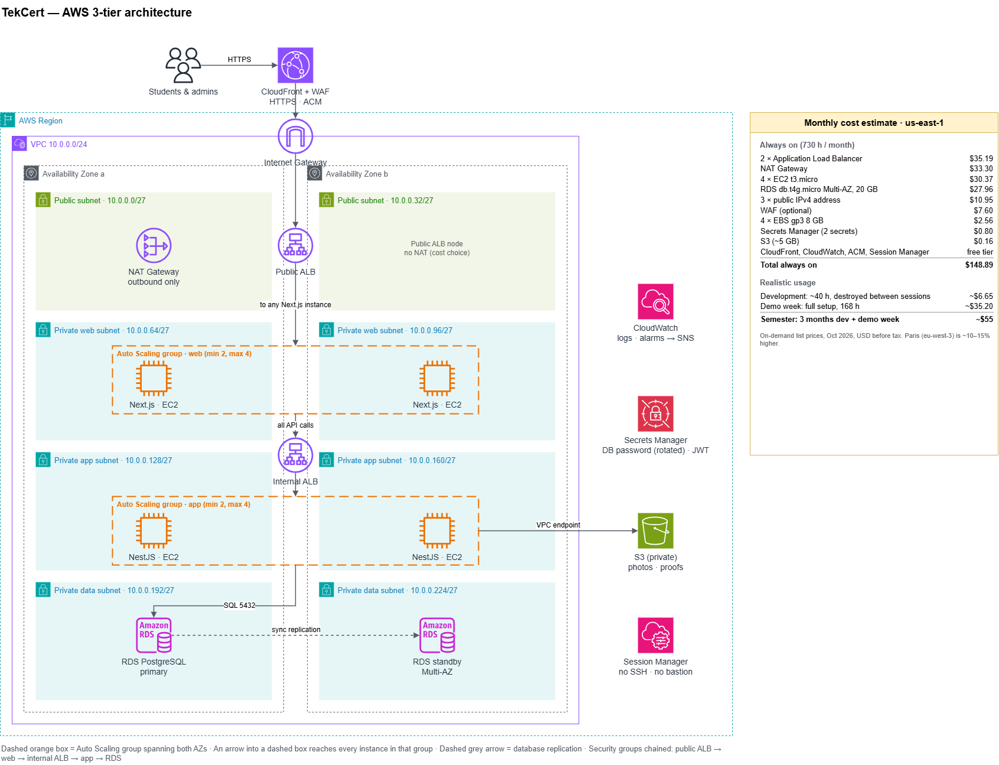

# TekCert

TekCert is a web platform where TEK-UP students prepare the IT certifications the institute funds
(AWS, Microsoft Azure, Cisco, Red Hat, Linux Foundation and more), track their progress, and find
classmates who can help them.

A semester group project for ING-4 CIM at TEK-UP University, built by a team of 4. This one
repository holds the product (`app/`) and the AWS infrastructure it runs on (`infra/`).

## What students can do (Release 1)

- **Sign up** with their `@tek-up.de` address and confirm it by email.
- **Onboard**: year, class and specialty, the certifications they already hold, a profile photo,
  then a recommended certification path.
- **Browse the catalog** of funded certifications, each with its page, chapters and badge.
- **Make progress**: tick chapters to earn points (an append-only ledger) and follow it on the
  dashboard.
- **Find help**: a community directory shows who holds, or is preparing, each certification.
- **Compare**: a leaderboard by class, specialty or the whole institute, by month.
- **Stay informed**: notifications, plus settings for privacy, notifications and account.

Release 2 (declaring a certification with proof, staff review, exam requests, practice tests,
French and Arabic) is in the backlog: see [`app/PLAN.md`](app/PLAN.md).

## Architecture



Three tiers on AWS, in one VPC across two availability zones:

| Tier | Runs | Reached from |
|---|---|---|
| Web | Next.js (port 3000) in an Auto Scaling group | CloudFront → public load balancer |
| App | NestJS REST API (port 4000) in an Auto Scaling group | the web tier, through an internal load balancer |
| Data | PostgreSQL 16 on RDS | the app tier only, no internet route |

The browser never calls the API: Next.js calls it server-side. The load balancers check the web app
at `/healthz` and the API at `/health`. Configuration comes from environment variables, and secrets
from AWS Secrets Manager. The diagram's source is
[`docs/AWS-Architecture-V1.drawio`](docs/AWS-Architecture-V1.drawio).

## Stack

| Part | Technologies |
|---|---|
| Frontend | Next.js 16 (App Router, server components), Tailwind CSS v4, shadcn/ui (Radix) |
| Backend | NestJS 11, TypeORM, PostgreSQL 16, OpenAPI docs |
| Shared | pnpm workspaces + Turborepo, zod schemas shared by both apps, strict TypeScript |
| Tests | Vitest (web), Jest (API), Playwright (end-to-end, accessibility, screenshots) |
| Infrastructure | Terraform (`hashicorp/aws ~> 6.0`), AWS Academy Learner Lab, `us-east-1` |
| CI | GitHub Actions |

## Repository layout

| Path | Contents |
|---|---|
| [`app/`](app/README.md) | The product: `frontend/`, `backend/`, `packages/` (types, ui, config), `e2e/`, the HTML designs, the plan and one file per sprint |
| [`infra/`](infra/README.md) | Terraform: `modules/` (network, alb, compute) and the `envs/dev` root module |
| `docs/` | The AWS architecture diagram |
| `.github/workflows/ci.yml` | CI for the app |
| `CLAUDE.md` | Rules for working on the repository with Claude Code (it imports `app/CLAUDE.md` and `infra/CLAUDE.md`) |

## Getting started

You need Node 24 (pinned in `app/.nvmrc`), pnpm through Corepack (`corepack enable`) and Docker
Desktop. Then, from `app/`:

```bash
cp backend/.env.example backend/.env
cp frontend/.env.example frontend/.env.local
pnpm install
pnpm db:up && pnpm db:migrate && pnpm db:seed
pnpm dev
```

The app opens on http://localhost:3000, the API docs on http://localhost:4000/docs, and every email
the app sends lands in Mailpit on http://localhost:8025. Sign up with any `@tek-up.de` address.

[`app/README.md`](app/README.md) has the full guide: every command, the tests and the deploy
bundles. [`infra/README.md`](infra/README.md) explains the Terraform setup, including a primer for
first-time Terraform users.

## Quality checks

On every pull request and every push to `main`, CI runs, from `app/`:

```bash
pnpm format:check && pnpm lint && pnpm typecheck
pnpm test        # unit tests
pnpm test:api    # API end-to-end tests against PostgreSQL
pnpm build
pnpm test:e2e    # Playwright on desktop and phone sizes, against the production builds
```

## Status

- **Release 1 (sprints S00 to S08)** is built and merged into `main`.
- **Infrastructure:** the network, compute and load balancer modules are written. RDS, the S3
  bucket, CloudFront with WAF and HTTPS, and monitoring come next. Nothing is deployed yet.
- **Next:** a staging environment on AWS, then a pilot with one class.

## How the team works

- One branch and one pull request per piece of work, cut from `main`, with
  [conventional commits](https://www.conventionalcommits.org/).
- **App:** one sprint at a time. Each sprint is planned and approved first, then built, tested and
  checked off in its file under [`app/sprints/`](app/sprints). Decisions are recorded in
  [`app/docs/decisions.md`](app/docs/decisions.md).
- **Infra:** run `terraform fmt` and `validate` after each change and read every `plan` before an
  `apply`. Only one person applies, from the shared lab account. Tear the lab down with
  `terraform destroy` after each session to stay within the budget.
- Secrets never go into the code or into `.tfvars` files.
